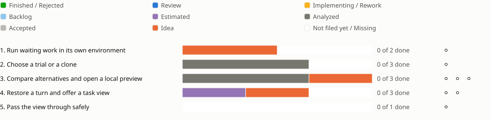

<!-- Generated by porelo-release plan render; do not edit. -->
# Release 0.10

Try waiting work before approval, compare alternatives and open a limited preview

*Stand: 2026-10-29T13:59:57Z*

## Sprint progress

Each sprint ends in functions the operator tests by hand; a bar shows the states of a sprint's issues, and a mark per function shows whether it is tested.

## Issues Details

<table><tr><td>

### Sprint 1: Run waiting work in its own environment

The person tries a waiting commit without giving it the gate or vault.

**Run waiting work in its own environment ⚪ Not tested**

Test: Run a waiting commit with gate try and read its streamed result. Try to reach the gate and vault from the trial; both are refused. Cancel the run and confirm its environment is removed.

🟧 [B95](https://github.com/porelo-ai/porelo/blob/main/issues/base/README.md#b95 "porelo#B95 · Idea · - · Pinned gate try in a throw-away container with source/risk limits; no gate route, E0/C3 no egress, bounded scanner import; IDE backend remains separate follow-up.") ◻️ Create An Isolated Review Trial; Stream Review Trial Results. The SARIF review path in release 0.8 is a prerequisite.

</td></tr></table>

<table><tr><td>

### Sprint 2: Choose a trial or a clone

The interface tests exactly the work the person selected.

**Choose a trial or a clone ⚪ Not tested**

Test: Run a waiting commit in a trial container from the interface, then fetch the same commit into a chosen clone. Commit and result are visible. Choose a clone holding other or unsaved work; that work must not be overwritten.

⬛ [F74](https://github.com/porelo-ai/porelo-frontend/blob/main/issues/README.md#f74 "porelo-frontend#F74 · Analyzed · M · A Waiting Push's Tests Run In A Container Of Its Own") ⬛ [F95](https://github.com/porelo-ai/porelo-frontend/blob/main/issues/README.md#f95 "porelo-frontend#F95 · Analyzed · M · A Waiting Push Fetched Here, Into A Clone Chosen") ◻️ Confirm how local, WSL and SSH targets are addressed before building this step.

</td></tr></table>

<table><tr><td>

### Sprint 3: Compare alternatives and open a local preview

The person chooses one result and reaches a task preview through host loopback only.

**Approve one of several attempts ⚪ Not tested**

Test: Start several attempts from one commit, read their differences and approve one. The other attempts are rejected; any rate limit is shown for the affected attempt.

⬛ [B163](https://github.com/porelo-ai/porelo/blob/main/issues/base/README.md#b163 "porelo#B163 · Analyzed · L · Grouped attempts start at one commit; compare per-attempt risk/build/SARIF evidence and enforce selected-commit controls; safe cleanup preserves pending replies and pins.")

**Several agents build the same work, one more compares them ⚪ Not tested**

Test: Start the same issue with two agents or models side by side; a comparing agent names the better result and why, and each run's wall time, tokens and cost are shown beside it. A finished issue built again is compared against its own commit.

🟧 [PJ77](https://github.com/porelo-ai/porelo-project/blob/main/issues/README.md#pj77 "porelo-project#PJ77 · Idea · — · Agents compared on the same work")

**Open a task port locally ⚪ Not tested**

Test: Start a web server in the task and open its port. Host-loopback access works; access from the network or through another account's relay socket is refused.

⬛ [B165](https://github.com/porelo-ai/porelo/blob/main/issues/base/README.md#b165 "porelo#B165 · Analyzed · M · A Port Of A Task On Loopback Only")

</td></tr></table>

<table><tr><td>

### Sprint 4: Restore a turn and offer a task view

The person can restore files and explicitly enable a limited screen view.

**Return to the chosen files ⚪ Not tested**

Test: Create two turn snapshots, rewind and compare the restored files. An unsupported session restore must be explained, with a restart offered where appropriate.

🟪 [B164](https://github.com/porelo-ai/porelo/blob/main/issues/base/README.md#b164 "porelo#B164 · Estimated · L · Rollback Points Inside A Task")

**Offer a screen only when enabled ⚪ Not tested**

Test: Start projects with and without a task view. Without permission there is no access; with permission only the intended socket is offered.

🟧 [B100](https://github.com/porelo-ai/porelo/blob/main/issues/base/README.md#b100 "porelo#B100 · Idea · - · A Task Can Be Looked At") ◻️ Expose A Task View Socket. This parent also covers the next sprint.

</td></tr></table>

<table><tr><td>

### Sprint 5: Pass the view through safely

Task and review views require the correct strong token.

**Pass the view through safely ⚪ Not tested**

Test: Open task and trial views. Use no token and a wrong token; no byte may reach the VNC server. End each view and confirm the relay and its processes are gone.

◻️ Authenticate The Task View Relay; Provide Task View Image Tools; Open A Review Trial View. Continue the task-view parent from sprint 4.

</td></tr></table>

## Waits

- [F74](https://github.com/porelo-ai/porelo-frontend/blob/main/issues/README.md#f74 "porelo-frontend#F74 · Analyzed · M · A Waiting Push's Tests Run In A Container Of Its Own") · Analyzed after [B95](https://github.com/porelo-ai/porelo/blob/main/issues/base/README.md#b95 "porelo#B95 · Idea · - · Pinned gate try in a throw-away container with source/risk limits; no gate route, E0/C3 no egress, bounded scanner import; IDE backend remains separate follow-up.") · Idea, [B293](https://github.com/porelo-ai/porelo/blob/main/issues/base/README.md#b293 "porelo#B293 · Idea · - · Daemon-authenticated source levels and deterministic C0-C3 rules constrain delivery, builds, secrets, replies and required human approvals; policies only tighten defaults.") · Idea
- [F95](https://github.com/porelo-ai/porelo-frontend/blob/main/issues/README.md#f95 "porelo-frontend#F95 · Analyzed · M · A Waiting Push Fetched Here, Into A Clone Chosen") · Analyzed after [B323](https://github.com/porelo-ai/porelo/blob/main/issues/base/README.md#b323 "porelo#B323 · Idea · - · The daemon derives each item's source level from authenticated evidence and the C0-C3 class from rules over the complete change, and carries both with waiting work, comments and findings; nothing is refused by them yet") · Idea

