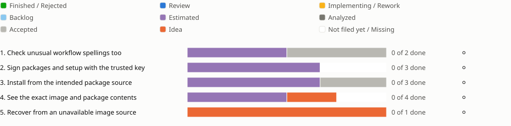

<!-- Generated by porelo-release plan render; do not edit. -->
# Release 0.12

Installed packages, setup scripts and images have a verifiable origin

*Stand: 2026-10-29T13:28:27Z*

## Sprint progress

Each sprint ends in functions the operator tests by hand; a bar shows the states of a sprint's issues, and a mark per function shows whether it is tested.

## Issues Details

<table><tr><td>

### Sprint 1: Check unusual workflow spellings too

A different YAML spelling cannot bypass a supply-chain check.

**Check unusual workflow spellings too ⚪ Not tested**

Test: Build every Maven repository with the corrected parent. Restore a plugin version with a known advisory; the check names it. Offer the same forbidden workflow permission normally, quoted and in flow YAML; all forms are refused.

🟪 [B210](https://github.com/porelo-ai/porelo/blob/main/issues/base/README.md#b210 "porelo#B210 · Estimated · L · Build Plugins Without Their Known Advisories") ⬜ [BT30](https://github.com/porelo-ai/porelo-buildtools/blob/main/issues/README.md#bt30 "porelo-buildtools#BT30 · Accepted · - · Check Actions Reads Workflows As YAML")

</td></tr></table>

<table><tr><td>

### Sprint 2: Sign packages and setup with the trusted key

Only correctly signed publications are offered and installed.

**Sign packages and setup with the trusted key ⚪ Not tested**

Test: Install Porelo and the Claude Code adapter from their joint published version. Verify the RPM and versioned setup script. Send an unsigned package and one signed by another key through publication and installation; both paths refuse them.

🟪 [B99](https://github.com/porelo-ai/porelo/blob/main/issues/base/README.md#b99 "porelo#B99 · Estimated · L · Packages Signed And Checked") 🟪 [CC23](https://github.com/porelo-ai/porelo-claude-code/blob/main/issues/README.md#cc23 "porelo-claude-code#CC23 · Estimated · S · Sign the RPMs, together with Porelo's") ◻️ Confirm the other packages named by the signing parent before starting the joint change.

</td></tr></table>

<table><tr><td>

### Sprint 3: Install from the intended package source

A fresh machine trusts the correct source and keeps signature checking enabled.

**Install from the intended package source ⚪ Not tested**

Test: Install through the interface on fresh Fedora and Debian or Ubuntu. Change the setup script; it must not run. Offer an agent package with the same name from another source; it is not selected. Install the correctly signed package and confirm package checking remains enabled.

🟪 [B196](https://github.com/porelo-ai/porelo/blob/main/issues/base/README.md#b196 "porelo#B196 · Estimated · S · The Fedora Repository Checked By Its Key") 🟪 [F81](https://github.com/porelo-ai/porelo-frontend/blob/main/issues/README.md#f81 "porelo-frontend#F81 · Estimated · M · The Setup Script Checked By Its Signature") ⬜ [B260](https://github.com/porelo-ai/porelo/blob/main/issues/base/README.md#b260 "porelo#B260 · Accepted · M · Only Porelo's Own Source Installs An Agent")

</td></tr></table>

<table><tr><td>

### Sprint 4: See the exact image and package contents

The person can identify the fixed parts that are running.

**See the exact image and package contents ⚪ Not tested**

Test: Read package contents or its SBOM. Follow a project with an image tag alone; start is refused until an explicit one-time exception. Change the digest; the next start names the change. Check a moving runner name; it is refused while a versioned runner is accepted.

🟪 [B41](https://github.com/porelo-ai/porelo/blob/main/issues/base/README.md#b41 "porelo#B41 · Estimated · M · What a Packaged Agent Installs") 🟪 [B98](https://github.com/porelo-ai/porelo/blob/main/issues/base/README.md#b98 "porelo#B98 · Estimated · M · The Image A Signature Names") 🟧 [BT18](https://github.com/porelo-ai/porelo-buildtools/blob/main/issues/README.md#bt18 "porelo-buildtools#BT18 · Idea · - · A Runner Named By Its Version") ◻️ Apply an image signature policy only within its explicitly chosen scope.

</td></tr></table>

<table><tr><td>

### Sprint 5: Recover from an unavailable image source

An image build tries a configured second source after a bounded first attempt.

**Recover from an unavailable image source ⚪ Not tested**

Test: Make the first Ubuntu mirror stop answering and build the image. The first attempt ends within its bound and the configured fallback succeeds. An unknown source remains refused.

🟧 [B263](https://github.com/porelo-ai/porelo/blob/main/issues/base/README.md#b263 "porelo#B263 · Idea · - · A Task Image Built Past A Stalled Mirror")

</td></tr></table>

## Waits

- [F81](https://github.com/porelo-ai/porelo-frontend/blob/main/issues/README.md#f81 "porelo-frontend#F81 · Estimated · M · The Setup Script Checked By Its Signature") · Estimated after [B99](https://github.com/porelo-ai/porelo/blob/main/issues/base/README.md#b99 "porelo#B99 · Estimated · L · Packages Signed And Checked") · Estimated
- [CC23](https://github.com/porelo-ai/porelo-claude-code/blob/main/issues/README.md#cc23 "porelo-claude-code#CC23 · Estimated · S · Sign the RPMs, together with Porelo's") · Estimated after [B99](https://github.com/porelo-ai/porelo/blob/main/issues/base/README.md#b99 "porelo#B99 · Estimated · L · Packages Signed And Checked") · Estimated

