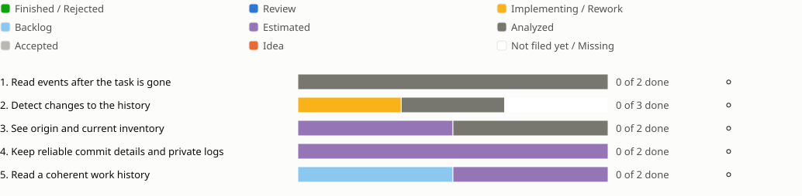

<!-- Generated by porelo-release plan render; do not edit. -->
# Release 0.15

Trace what a task did, where its work came from and what was approved

*Stand: 2026-10-29T19:11:50Z*

## Sprint progress

Each sprint ends in functions the operator tests by hand; a bar shows the states of a sprint's issues, and a mark per function shows whether it is tested.

## Issues Details

<table><tr><td>

### Sprint 1: Read events after the task is gone

The past remains readable through the terminal and daemon.

**Read events after the task is gone ⚪ Not tested**

Test: Start, push and remove a task. Clear its runtime directory or restart the machine. Read events using a cursor and older log windows; order and truncation markers are correct. The event journal contains neither credentials nor unrestricted agent output.

⬛ [B26](https://github.com/porelo-ai/porelo/blob/main/issues/base/README.md#b26 "porelo#B26 · Analyzed · L · What This Machine Has Been Doing") ⬛ [B116](https://github.com/porelo-ai/porelo/blob/main/issues/base/README.md#b116 "porelo#B116 · Analyzed · M · A Log Read Back In Windows")

</td></tr></table>

<table><tr><td>

### Sprint 2: Detect changes to the history

Approval evidence remains verifiable after clear.

**Detect changes to the history ⚪ Not tested**

Test: Approve, reject and change a credential. Change a journal line and truncate the end; verification names both changes. Run clear; the evidence remains. Remove the old message hash chain only after this proof.

🟨 [B154](https://github.com/porelo-ai/porelo/blob/main/issues/base/README.md#b154 "porelo#B154 · Implementing · L · A Tamper-Evident Event Log Per Node") ⬛ [B121](https://github.com/porelo-ai/porelo/blob/main/issues/base/README.md#b121 "porelo#B121 · Analyzed · M · A Message Record Without A Chain") ◻️ Use the shared event journal, without a second journal implementation.

</td></tr></table>

<table><tr><td>

### Sprint 3: See origin and current inventory

The person can trace a handover and read what the account operates.

**See origin and current inventory ⚪ Not tested**

Test: Hand over a file, let the task modify files and remove it. Origin and change size remain readable. Compare text and JSON inventory: agents, providers, credentials, projects, models and last use agree; secret values are absent.

⬛ [B38](https://github.com/porelo-ai/porelo/blob/main/issues/base/README.md#b38 "porelo#B38 · Analyzed · L · How Far Something That Got Through Can Get") 🟪 [B156](https://github.com/porelo-ai/porelo/blob/main/issues/base/README.md#b156 "porelo#B156 · Estimated · M · porelo inventory")

</td></tr></table>

<table><tr><td>

### Sprint 4: Keep reliable commit details and private logs

Commit origin comes from the host and logs disclose no secrets.

**Keep reliable commit details and private logs ⚪ Not tested**

Test: Approve work from different models and read the merge trailers. Offer forged agent details; they cannot replace the host record. Send a test secret through broker and gate; it appears in no log. File permissions and retention match the stated rules.

🟪 [B144](https://github.com/porelo-ai/porelo/blob/main/issues/base/README.md#b144 "porelo#B144 · Estimated · L · AI Provenance In The Commit") 🟪 [B155](https://github.com/porelo-ai/porelo/blob/main/issues/base/README.md#b155 "porelo#B155 · Estimated · M · The Logs Checked And Documented")

</td></tr></table>

<table><tr><td>

### Sprint 5: Read a coherent work history

Session replay and the filtered timeline show the same sequence.

**Read a coherent work history ⚪ Not tested**

Test: Create a session with terminal, broker and gate events. Replay it and filter the timeline by source; time order is retained. Reach size and retention limits; neither host nor interface blocks.

🟪 [B168](https://github.com/porelo-ai/porelo/blob/main/issues/base/README.md#b168 "porelo#B168 · Estimated · M · A Recording Of Each Session") 🔲 [F111](https://github.com/porelo-ai/porelo-frontend/blob/main/issues/README.md#f111 "porelo-frontend#F111 · Backlog · M · All Of A Piece's Logs In One Timeline")

</td></tr></table>

