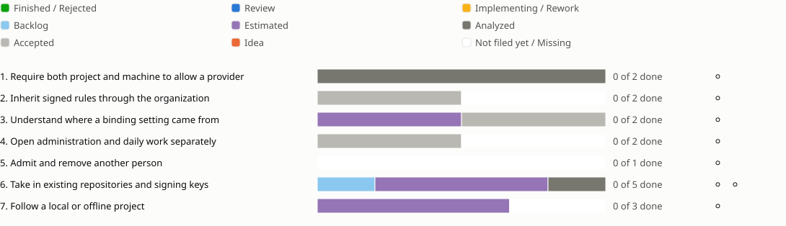

<!-- Generated by porelo-release plan render; do not edit. -->
# Release 0.16

Manage organization rules and personal access, and take in existing projects

*Stand: 2026-10-29T19:11:50Z*

## Sprint progress

Each sprint ends in functions the operator tests by hand; a bar shows the states of a sprint's issues, and a mark per function shows whether it is tested.

## Issues Details

<table><tr><td>

### Sprint 1: Require both project and machine to allow a provider

A developer cannot bypass the narrower provider list.

**Require both project and machine to allow a provider ⚪ Not tested**

Test: Configure different provider lists in the project and a root-owned machine rule. Start a provider allowed by both. Try a provider allowed at only one level and a custom provider definition; both are refused with a reason.

⬛ [B151](https://github.com/porelo-ai/porelo/blob/main/issues/base/README.md#b151 "porelo#B151 · Analyzed · M · The Providers A Project Allows") ⬛ [PJ16](https://github.com/porelo-ai/porelo-project/blob/main/issues/README.md#pj16 "porelo-project#PJ16 · Analyzed · L · An organisation decides which providers its machines use")

</td></tr></table>

<table><tr><td>

### Sprint 2: Inherit signed rules through the organization

A team or project can narrow a rule only as its parent permits.

**Inherit signed rules through the organization ⚪ Not tested**

Test: Connect organization, team and project settings and narrow an allowed value. Try to widen a fixed value, alter a signature and insert an unrelated project. The permitted narrowing works; all three bypasses are refused by name.

⬜ [B198](https://github.com/porelo-ai/porelo/blob/main/issues/base/README.md#b198 "porelo#B198 · Accepted · - · Settings Inherited Down An Organisation's Tree") ◻️ Pin An Organization Root; Verify The Settings Chain; Inherit Organization Settings; Enforce Fixed And Narrow-Only Settings.

</td></tr></table>

<table><tr><td>

### Sprint 3: Understand where a binding setting came from

The interface explains each setting's origin and allowed changes.

**Understand where a binding setting came from ⚪ Not tested**

Test: Open machine and project settings, read their rule chain and effective providers, and try changing a locked setting. The interface explains its origin and the permitted next step; the daemon still refuses the forbidden change.

🟪 [F62](https://github.com/porelo-ai/porelo-frontend/blob/main/issues/README.md#f62 "porelo-frontend#F62 · Estimated · M · An Organisation's Policy Is Shown") ⬜ [F123](https://github.com/porelo-ai/porelo-frontend/blob/main/issues/README.md#f123 "porelo-frontend#F123 · Accepted · — · Where A Machine And A Project Stand In Their Organisation's Tree")

</td></tr></table>

<table><tr><td>

### Sprint 4: Open administration and daily work separately

Each role offers its intended work area and a usable access route.

**Open administration and daily work separately ⚪ Not tested**

Test: Open the interface as user, host-admin and access-admin. Walk setup, admitting a person and daily work. Each role sees its intended functions; the stated SSH and VPN routes can actually be reached.

⬜ [PJ71](https://github.com/porelo-ai/porelo-project/blob/main/issues/README.md#pj71 "porelo-project#PJ71 · Accepted · — · Who reaches a host, and by which way") ◻️ Separate Administrative Entry Points; Define Host Access Routes. Roles choose the offered functions and add no separate authorization check. Decide access routes before implementation; this parent also covers sprint 5.

</td></tr></table>

<table><tr><td>

### Sprint 5: Admit and remove another person

Personal access does not require sharing a private key.

**Admit and remove another person ⚪ Not tested**

Test: Admit a second computer with its own key and reach the intended services. Remove that person; their access ends while the other person's access remains. The handover file contains no private key.

◻️ Exchange Public Access Requests; Provision Personal Host Access; Revoke Personal Host Access. Continue sprint 4 after deciding account, forge and room access.

</td></tr></table>

<table><tr><td>

### Sprint 6: Take in existing repositories and signing keys

The person chooses from what already exists and sees the actual token state.

**Choose a repository and signing key ⚪ Not tested**

Test: Read all default repositories. Choose a signing key from a file or create one and inspect it in the shared overview. An unsuitable key is refused.

🔲 [F147](https://github.com/porelo-ai/porelo-frontend/blob/main/issues/README.md#f147 "porelo-frontend#F147 · Backlog · XS · Every Repository Of Default Offered To Start In") 🟪 [F84](https://github.com/porelo-ai/porelo-frontend/blob/main/issues/README.md#f84 "porelo-frontend#F84 · Estimated · M · A Signing Key Found Or Made From The Window") 🟪 [F94](https://github.com/porelo-ai/porelo-frontend/blob/main/issues/README.md#f94 "porelo-frontend#F94 · Estimated · M · A Project's Keys Told In One Place")

**Recognize a token awaiting organization approval ⚪ Not tested**

Test: Create a project against the GitHub test organization with a token awaiting approval. The interface says it is waiting for approval instead of calling it invalid; after approval the operation succeeds.

⬛ [F115](https://github.com/porelo-ai/porelo-frontend/blob/main/issues/README.md#f115 "porelo-frontend#F115 · Analyzed · S · A Fine-Grained Token Waiting For An Organisation's Approval") 🟪 [F59](https://github.com/porelo-ai/porelo-frontend/blob/main/issues/README.md#f59 "porelo-frontend#F59 · Estimated · S · A Project From A Repository, Measured Against GitHub")

</td></tr></table>

<table><tr><td>

### Sprint 7: Follow a local or offline project

Project intake works without a public repository.

**Follow a local or offline project ⚪ Not tested**

Test: Select a directory and bundle, watch the upload and reconnect. The followed project is recognized as a file source. A bundle above 1 GiB, a disallowed path and a damaged bundle are refused.

🟪 [B160](https://github.com/porelo-ai/porelo/blob/main/issues/base/README.md#b160 "porelo#B160 · Estimated · M · A Project Followed From A File Over The Socket") 🟪 [F104](https://github.com/porelo-ai/porelo-frontend/blob/main/issues/README.md#f104 "porelo-frontend#F104 · Estimated · M · A Project Followed From A File") ◻️ Deliver the core upload before the interface flow.

</td></tr></table>

## Waits

- [F62](https://github.com/porelo-ai/porelo-frontend/blob/main/issues/README.md#f62 "porelo-frontend#F62 · Estimated · M · An Organisation's Policy Is Shown") · Estimated after [PJ16](https://github.com/porelo-ai/porelo-project/blob/main/issues/README.md#pj16 "porelo-project#PJ16 · Analyzed · L · An organisation decides which providers its machines use") · Analyzed
- [F104](https://github.com/porelo-ai/porelo-frontend/blob/main/issues/README.md#f104 "porelo-frontend#F104 · Estimated · M · A Project Followed From A File") · Estimated after [B160](https://github.com/porelo-ai/porelo/blob/main/issues/base/README.md#b160 "porelo#B160 · Estimated · M · A Project Followed From A File Over The Socket") · Estimated
- [F123](https://github.com/porelo-ai/porelo-frontend/blob/main/issues/README.md#f123 "porelo-frontend#F123 · Accepted · — · Where A Machine And A Project Stand In Their Organisation's Tree") · Accepted after [B198](https://github.com/porelo-ai/porelo/blob/main/issues/base/README.md#b198 "porelo#B198 · Accepted · - · Settings Inherited Down An Organisation's Tree") · Accepted

