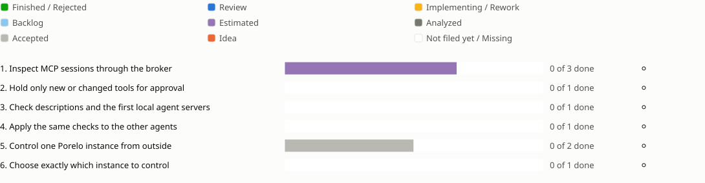

<!-- Generated by porelo-release plan render; do not edit. -->
# Release 0.18

Keep MCP tools inspectable and require approval when their accepted definitions change

*Stand: 2026-10-29T16:05:36Z*

## Sprint progress

Each sprint ends in functions the operator tests by hand; a bar shows the states of a sprint's issues, and a mark per function shows whether it is tested.

## Issues Details

<table><tr><td>

### Sprint 1: Inspect MCP sessions through the broker

Tool lists and calls are visible without giving the task a server credential.

**Inspect MCP sessions through the broker ⚪ Not tested**

Test: Use an HTTP MCP stand-in through the gateway and read its tool list and calls in the journal. Search the task for the server credential; it is absent. A local host command under mcp: is refused.

🟪 [B167](https://github.com/porelo-ai/porelo/blob/main/issues/base/README.md#b167 "porelo#B167 · Estimated · L · An MCP Gateway On The Host") 🟪 [PJ15](https://github.com/porelo-ai/porelo-project/blob/main/issues/README.md#pj15 "porelo-project#PJ15 · Estimated · XL · A tool does not change behind the person's back") ◻️ Measure MCP Sessions Through The Broker. The tool parent also covers sprints 2 through 4; organization rules and audit records must work first.

</td></tr></table>

<table><tr><td>

### Sprint 2: Hold only new or changed tools for approval

An unchanged accepted tool keeps working while others wait for consent.

**Hold only new or changed tools for approval ⚪ Not tested**

Test: Accept two tools, leave one unchanged, change the second and add a third. The unchanged tool works; only the changed and new tools wait in Needs you. Reject them; they stay blocked.

◻️ Pin Accepted MCP Tools; Accept Tool Changes In Needs You. Continue sprint 1.

</td></tr></table>

<table><tr><td>

### Sprint 3: Check descriptions and the first local agent servers

Tool descriptions and local servers cannot bypass the configured checks.

**Check descriptions and the first local agent servers ⚪ Not tested**

Test: Trigger a description rule with a known counterexample. Start pinned Claude Code and Pi local servers, then change each package or digest; the changed start fails. The rule makes no claim of unlimited protection against prompt injection.

◻️ Check MCP Tool Descriptions; Pin Claude Code Local MCP Servers; Pin Pi Local MCP Servers. Continue sprint 2.

</td></tr></table>

<table><tr><td>

### Sprint 4: Apply the same checks to the other agents

Every supported agent starts only the accepted local server contents.

**Apply the same checks to the other agents ⚪ Not tested**

Test: For OMP, Codex and Antigravity, start an allowed server package and then alter its contents. The allowed version works; a changed or unlisted version is refused.

◻️ Pin OMP Local MCP Servers; Pin Codex Local MCP Servers; Pin Antigravity Local MCP Servers. Confirm the final supported-agent list before splitting these parts.

</td></tr></table>

<table><tr><td>

### Sprint 5: Control one Porelo instance from outside

An external agent starts and observes tasks but cannot approve work or unlock the vault.

**Control one Porelo instance from outside ⚪ Not tested**

Test: Start a task, read status and send a message over MCP. Then try approve, reject and vault unlock; those operations are unavailable or explicitly refused.

⬜ [PJ35](https://github.com/porelo-ai/porelo-project/blob/main/issues/README.md#pj35 "porelo-project#PJ35 · Accepted · — · An agent orchestrates Porelo machines") ◻️ Control One Porelo Instance Over MCP; Refuse Approval And Vault Operations. This parent also covers sprint 6.

</td></tr></table>

<table><tr><td>

### Sprint 6: Choose exactly which instance to control

A control request affects only the selected machine.

**Choose exactly which instance to control ⚪ Not tested**

Test: Configure two instances, start a task on one and perform an allowed setup step there. A wrong instance identifier and a forbidden administrative action are refused; the other instance remains untouched.

◻️ Address Multiple Porelo Instances; Control Permitted Machine Setup. Continue sprint 5 after deciding administrative scope and spending authority.

</td></tr></table>

