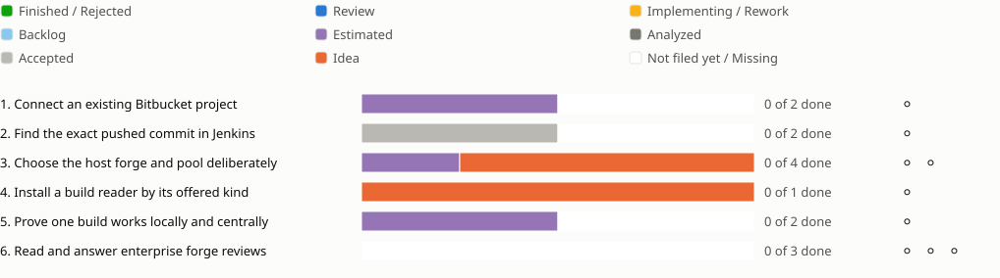

<!-- Generated by porelo-release plan render; do not edit. -->
# Release 0.19

Use enterprise forges, read Jenkins builds and extend reviews to their pull requests

*Stand: 2026-10-28T12:30:30Z*

## Sprint progress

Each sprint ends in functions the operator tests by hand; a bar shows the states of a sprint's issues, and a mark per function shows whether it is tested.

## Issues Details

<table><tr><td>

### Sprint 1: Connect an existing Bitbucket project

A Bitbucket Data Center repository works through the ordinary setup flow.

**Connect an existing Bitbucket project ⚪ Not tested**

Test: Connect the test installation, read the identity and take in a repository as a project. Offer a token without the required rights and a wrong host key; both are clearly refused.

🟪 [F72](https://github.com/porelo-ai/porelo-frontend/blob/main/issues/README.md#f72 "porelo-frontend#F72 · Estimated · L · Forges Beyond GitHub") ◻️ Separate Forge Connection Behavior; Connect Bitbucket Data Center. A test installation and evaluation license are prerequisites.

</td></tr></table>

<table><tr><td>

### Sprint 2: Find the exact pushed commit in Jenkins

A task receives its own build result without holding a Jenkins credential.

**Find the exact pushed commit in Jenkins ⚪ Not tested**

Test: Push a green and a red commit. The task receives commit, stages, verdict and the failing log. Offer a build of another commit; it is not accepted as the result of this push. The task contains no Jenkins credential.

⬜ [PJ36](https://github.com/porelo-ai/porelo-project/blob/main/issues/README.md#pj36 "porelo-project#PJ36 · Accepted · — · Builds read from Bitbucket Data Center and Jenkins") ◻️ Read Jenkins Builds Independently Of The Forge; Match Bitbucket Pushes To Jenkins Builds. The build contract from release 0.6 must work first.

</td></tr></table>

<table><tr><td>

### Sprint 3: Choose the host forge and pool deliberately

The person selects forge repositories and build machines before work is run.

**Configure forge repositories and a pool ⚪ Not tested**

Test: Choose the forge, repositories and pool through the dialog and CLI. Omit the required central token; setup refuses before creating a partial forge. With complete inputs, the same workflow uses the local pool and a central rented machine.

🟪 [F145](https://github.com/porelo-ai/porelo-frontend/blob/main/issues/README.md#f145 "porelo-frontend#F145 · Estimated · S · The Host's Forge Switched Off In The Server Setup") 🟧 [F146](https://github.com/porelo-ai/porelo-frontend/blob/main/issues/README.md#f146 "porelo-frontend#F146 · Idea · — · The Host's VM Pool Switched On") 🟧 [HO27](https://github.com/porelo-ai/porelo-host/blob/main/issues/README.md#ho27 "porelo-host#HO27 · Idea · - · The Forge's Jobs Told Where The Pool Is")

**Request a declared build from the task ⚪ Not tested**

Test: Ask a task to build on a declared kind and read the result in its files. An undeclared kind or command is refused; the task receives no machine credential.

🟧 [B254](https://github.com/porelo-ai/porelo/blob/main/issues/base/README.md#b254 "porelo#B254 · Idea · - · A Task Has Its Work Built on a Declared Kind")

</td></tr></table>

<table><tr><td>

### Sprint 4: Install a build reader by its offered kind

The person chooses a build reader without knowing its package name.

**Install a build reader by its offered kind ⚪ Not tested**

Test: Read the setup --list and daemon Installable catalogs; reader packages appear as kind build-reader. Select and install one through setup --with and query a build through it. A package outside the declared catalog is refused.

🟧 [B287](https://github.com/porelo-ai/porelo/blob/main/issues/base/README.md#b287 "porelo#B287 · Idea · - · Build Readers Offered Where Agents Are")

</td></tr></table>

<table><tr><td>

### Sprint 5: Prove one build works locally and centrally

A task sees the same complete build before and after the central push.

**Prove one build works locally and centrally ⚪ Not tested**

Test: Run every building repository's same workflow on the local and central forges without editing it. Resolve another repository's locally published artifact, including a child-module publication. Break that publication; the local run fails before any central tag. Request a declared machine kind, read the verdict and log in the task, and refuse undeclared kinds or commands.

🟪 [PJ22](https://github.com/porelo-ai/porelo-project/blob/main/issues/README.md#pj22 "porelo-project#PJ22 · Estimated · XL · One build, run locally as on the central forge") ◻️ Parent acceptance for one build, not duplicate implementation. This includes the forge, pool and task-build work from release 0.6 and this release; return the whole local VM after a run and keep provider names out of workflows.

</td></tr></table>

<table><tr><td>

### Sprint 6: Read and answer enterprise forge reviews

Each added forge converts its review data through the shared SARIF profile.

**Review a GitLab merge request ⚪ Not tested**

Test: Read GitLab threads and suggestions into the waiting work and release a reply back. Known authors follow the configured trust rule; an unknown author is held and a forged author cannot change that. A reply is sent only after its release.

◻️ Not yet filed: a GitLab review adapter from the review-area parent in release 0.8. Use the SARIF profile and the review contract, with conversion in both directions.

**Review a Bitbucket pull request ⚪ Not tested**

Test: Read Bitbucket Data Center threads and suggestions as SARIF and release a reply. An unknown author is held; an unreleased reply never appears online. A build-reader result cannot stand in for a review result.

◻️ Not yet filed: a Bitbucket review adapter from the review-area parent in release 0.8. This is separate work from the Bitbucket connection and Jenkins build reader.

**Review an Azure DevOps pull request ⚪ Not tested**

Test: Read Azure DevOps threads and suggestions as SARIF and release a reply. An unknown author is held; an unreleased reply never appears online. Refuse an unsupported mandatory review operation by name.

◻️ Not yet filed: an Azure DevOps review adapter from the review-area parent in release 0.8. Each forge has its own adapter under the shared review contract.

</td></tr></table>

