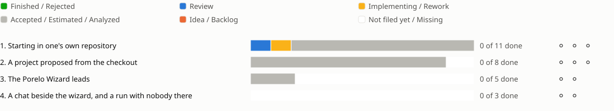

<!-- Generated by porelo-release plan render; do not edit. -->
# Release 0.7

A developer starts in a repository they already have, led by the Porelo Wizard

*Stand: 2026-10-23T17:47:28Z*

## Sprint progress

Each sprint ends in functions the operator tests by hand; a bar shows the states of a sprint's issues, and a mark per function shows whether it is tested.

## Issues Details

<table><tr><td>

### Sprint 1: Starting in one's own repository

A developer starts in a repository they already have, with no project written and no flags to learn.

**Work without a project, with plain refusals ⚪ Not tested**

Test: A task starts in a checkout in `default`; a followed project naming the repository is offered to take it; a repository with no commit, an unreadable upstream or a failed fetch is named as what it is, with the next step.

🟨 [PJ14](https://github.com/porelo-ai/porelo-project/blob/main/issues/README.md#pj14 "porelo-project#PJ14 · Implementing · M · Work starts without a project") ⬜ [B229](https://github.com/porelo-ai/porelo/blob/main/issues/base/README.md#b229 "porelo#B229 · Analyzed · S · A Follow Of A Repository Without A Commit Says So") ⬜ [B33](https://github.com/porelo-ai/porelo/blob/main/issues/base/README.md#b33 "porelo#B33 · Analyzed · S · A Task's Own Fetches") 🟦 [F118](https://github.com/porelo-ai/porelo-frontend/blob/main/issues/README.md#f118 "porelo-frontend#F118 · Review · — · An Upstream That Cannot Be Read Said Before A Start")

**The agent already on the machine is taken ⚪ Not tested**

Test: Without `--agent` and `--provider` the task starts with the Claude Code signed in there and says what it found and where; the interface shows the same choice.

⬜ [PJ53](https://github.com/porelo-ai/porelo-project/blob/main/issues/README.md#pj53 "porelo-project#PJ53 · Analyzed · XL · The agent already on the machine is the default") ⬜ [B225](https://github.com/porelo-ai/porelo/blob/main/issues/base/README.md#b225 "porelo#B225 · Analyzed · L · The Agent Found On The Machine") ⬜ [CC36](https://github.com/porelo-ai/porelo-claude-code/blob/main/issues/README.md#cc36 "porelo-claude-code#CC36 · Analyzed · S · Report What Claude Code Finds Of Itself On The Host") ⬜ [B224](https://github.com/porelo-ai/porelo/blob/main/issues/base/README.md#b224 "porelo#B224 · Analyzed · M · An Agent Protocol That Only Grows") ⬜ [F143](https://github.com/porelo-ai/porelo-frontend/blob/main/issues/README.md#f143 "porelo-frontend#F143 · Accepted · — · The Agent The Machine Found Is The Default")

**Keys and providers without stumbling ⚪ Not tested**

Test: A key pasted at `vault put` is read whole; an agent given a provider it does not know is refused before the start.

⬜ [B228](https://github.com/porelo-ai/porelo/blob/main/issues/base/README.md#b228 "porelo#B228 · Analyzed · S · A Key Pasted At The Prompt Is Read Whole") ⬜ [P09](https://github.com/porelo-ai/porelo/blob/main/issues/providers/README.md#p09 "porelo#P09 · Estimated · M · A Native Agent And A Provider It Does Not Know")

</td></tr></table>

<table><tr><td>

### Sprint 2: A project proposed from the checkout

Whoever needs more than the default image or `default` gets drafts from what the checkout already says.

**`porelo project init` proposes tools and rules ⚪ Not tested**

Test: For a Maven repository, a `.porelo.yml` and where needed a `project.yml` draft, each value with its source; a project kept in a local repository is read again at `refresh`.

⬜ [PJ52](https://github.com/porelo-ai/porelo-project/blob/main/issues/README.md#pj52 "porelo-project#PJ52 · Estimated · XL · A repository's build tools are recognized and a project proposed") ⬜ [B220](https://github.com/porelo-ai/porelo/blob/main/issues/base/README.md#b220 "porelo#B220 · Analyzed · M · Build-Tool Plugins Found At Run Time") ⬜ [B221](https://github.com/porelo-ai/porelo/blob/main/issues/base/README.md#b221 "porelo#B221 · Analyzed · L · A Project Proposed From A Checkout") ⬜ [B227](https://github.com/porelo-ai/porelo/blob/main/issues/base/README.md#b227 "porelo#B227 · Analyzed · S · A Project Followed From A Path Is Refreshed") ◻️ porelo-ecosystems, a new repository and agent, Maven first

**The drafts shown before the first task ⚪ Not tested**

Test: At the first start in `default`, the interface shows what the machine proposes, to take or leave.

⬜ [F142](https://github.com/porelo-ai/porelo-frontend/blob/main/issues/README.md#f142 "porelo-frontend#F142 · Analyzed · M · The Drafts Offered Before The First Task In Default")

**A company's private package repository, with no credential in the task ⚪ Not tested**

Test: A task builds against an authenticated Nexus or Artifactory; `settings.xml` is written at the start and the credential stays in the vault.

⬜ [B222](https://github.com/porelo-ai/porelo/blob/main/issues/base/README.md#b222 "porelo#B222 · Analyzed · M · A Task's Tool Settings Written At Its Start") ⬜ [B219](https://github.com/porelo-ai/porelo/blob/main/issues/base/README.md#b219 "porelo#B219 · Estimated · L · A Private Package Repository Through The Broker")

</td></tr></table>

<table><tr><td>

### Sprint 3: The Porelo Wizard leads

One way from an empty machine to the first reviewed work; the steps of sprints 1 and 2 become steps of its catalogue.

**Questions, a plan, and taken up again ⚪ Not tested**

Test: The questions first, the whole plan shown before anything runs, and after a pause it goes on where the person was; a step done elsewhere counts as done.

⬜ [PJ57](https://github.com/porelo-ai/porelo-project/blob/main/issues/README.md#pj57 "porelo-project#PJ57 · Accepted · — · A person is led from nothing to work") ◻️ porelo-wizard, a new repository ◻️ the catalogue of steps ◻️ the checks porelo still lacks

**A step for someone else handed over ⚪ Not tested**

Test: A step for an administrator comes as instructions and as a file to run; the wizard waits for its check.

◻️ hand-overs in the wizard

</td></tr></table>

<table><tr><td>

### Sprint 4: A chat beside the wizard, and a run with nobody there

Questions about the current step, and the same plan for many machines.

**A chat answers questions about the current step ⚪ Not tested**

Test: Beside the wizard, with the Claude Code already signed in on the machine; it never sees a secret and runs nothing unconfirmed.

◻️ the chat on flutter\_ai\_toolkit ◻️ the chat's Claude Code provider

**The same plan from a file of answers ⚪ Not tested**

Test: The wizard runs with nobody there for many machines; a step that needs a person stops it and says so.

◻️ a run from a file of answers

</td></tr></table>

