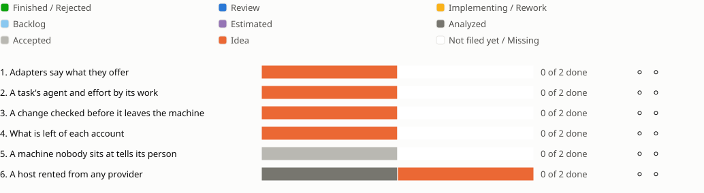

<!-- Generated by porelo-release plan render; do not edit. -->
# Release 0.8

Steering the work: the agents' work chosen, checked and paid for by rule

*Stand: 2026-10-25T12:58:03Z*

## Sprint progress

Each sprint ends in functions the operator tests by hand; a bar shows the states of a sprint's issues, and a mark per function shows whether it is tested.

## Issues Details

<table><tr><td>

### Sprint 1: Adapters say what they offer

Every adapter lists its services, each by its own contract, and a missing or deprecated function is said, not guessed.

**An adapter's services listed, a lacking one refused ⚪ Not tested**

Test: Porelo lists each installed adapter's services with contract, version and optional functions; an adapter that lacks a mandatory function is refused by name before any task needs it.

🟧 [PJ66](https://github.com/porelo-ai/porelo-project/blob/main/issues/README.md#pj66 "porelo-project#PJ66 · Idea · — · An adapter offers the services it has")

**A deprecated contract still taken, with a warning ⚪ Not tested**

Test: An adapter that speaks only a deprecated contract version still works, and every start that uses it says since when it is deprecated and in which release it goes.

◻️ the deprecated contracts in porelo (from PJ66)

</td></tr></table>

<table><tr><td>

### Sprint 2: A task's agent and effort by its work

The start of a task chooses agent, model and effort from its phase and its issue's risk, and says why.

**The choice shown with where it came from ⚪ Not tested**

Test: A task started for an issue in phase `check` with risk `harm` runs Claude Code at `xhigh`, and the start names the project's rule; a flag overrides it; the interface shows the same before the start.

🟧 [PJ64](https://github.com/porelo-ai/porelo-project/blob/main/issues/README.md#pj64 "porelo-project#PJ64 · Idea · — · A task chooses its agent and effort by its work")

**The operator's rule for a time ⚪ Not tested**

Test: A rule set by the operator moves `check` with `harm` to another agent; every start it changes names it with its date; once revoked, the project's rule applies again.

◻️ the operator's rule in porelo, its view in porelo-frontend (from PJ64)

</td></tr></table>

<table><tr><td>

### Sprint 3: A change checked before it leaves the machine

Work waiting at a gate is checked, fixed and checked again before the person approves it.

**Rounds of check and fix at the gate ⚪ Not tested**

Test: A build task pushes to its gate; a check task reads that commit and leaves findings; the build task wakes, fixes and pushes again; the next check is clean, or the rounds stop at their bound.

🟧 [PJ67](https://github.com/porelo-ai/porelo-project/blob/main/issues/README.md#pj67 "porelo-project#PJ67 · Idea · — · A change is checked before it leaves the machine")

**The person approves with every round in view ⚪ Not tested**

Test: `porelo gate review` and the interface show the diff with the last findings and the rounds before it; only the approval sends the work on.

◻️ findings shown at the gate in porelo and the interface (from PJ67)

</td></tr></table>

<table><tr><td>

### Sprint 4: What is left of each account

Every account the agents spend on, with what is left and when it comes back.

**The daily accounts read ⚪ Not tested**

Test: `porelo limits` shows two Claude Code subscriptions, Codex and Antigravity, each with its own meters, read time and source; an estimate is marked as such.

🟧 [PJ65](https://github.com/porelo-ai/porelo-project/blob/main/issues/README.md#pj65 "porelo-project#PJ65 · Idea · — · What is left of each provider's limits is shown")

**The accounts in the interface, the low ones first ⚪ Not tested**

Test: The interface shows every configured account as its kind reads best - a window's share as a bar with its reset, a quota as used of allowed - with a meter below its threshold warned and shown first.

◻️ the accounts' view in porelo-frontend (from PJ65)

</td></tr></table>

<table><tr><td>

### Sprint 5: A machine nobody sits at tells its person

A machine working alone says what needs its person - an expiring credential, a locked vault, a stopped service, a machine running short - wherever the person is.

**An expiring token told ahead ⚪ Not tested**

Test: A forge token set to expire soon on a host makes one message to the person, in the way they chose, naming the machine, the token, when it expires and how to renew it; it is not repeated until it changes.

⬜ [PJ70](https://github.com/porelo-ai/porelo-project/blob/main/issues/README.md#pj70 "porelo-project#PJ70 · Accepted · — · A machine nobody sits at tells its person what needs them")

**A stopped service told with its cause ⚪ Not tested**

Test: The room's homeserver stopped on a host makes one message naming the machine, the service, since when and its last error line; when it runs again, the person is told it is resolved.

◻️ the watcher in porelo, the person's ways of being told (from PJ70)

</td></tr></table>

<table><tr><td>

### Sprint 6: A host rented from any provider

A host is rented and given back through one OpenTofu module per provider, by the same `up` and `down` as today.

**Rented and given back through the module ⚪ Not tested**

Test: `porelo-host up` rents a Scaleway host through the module and `down` gives it back; afterwards `tofu plan` reads no change, and nothing tagged with the project is left at the provider.

⬛ [HO23](https://github.com/porelo-ai/porelo-host/blob/main/issues/README.md#ho23 "porelo-host#HO23 · Analyzed · L · A Machine Rented And Given Back By OpenTofu") 🟧 [F166](https://github.com/porelo-ai/porelo-frontend/blob/main/issues/README.md#f166 "porelo-frontend#F166 · Idea · M · A Host Rented Through OpenTofu")

**A state from another computer refused ⚪ Not tested**

Test: A tagged server the module's state lacks makes `up` refuse, naming it; a conflict copy of the state makes `up` and `down` refuse until a person keeps one.

🟧 [F166](https://github.com/porelo-ai/porelo-frontend/blob/main/issues/README.md#f166 "porelo-frontend#F166 · Idea · M · A Host Rented Through OpenTofu")

</td></tr></table>

