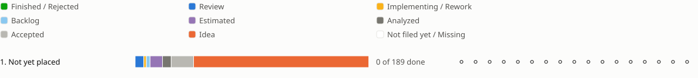

<!-- Generated by porelo-release plan render; do not edit. -->
# Release later

Everything not yet placed in a release

*Stand: 2026-11-04T04:49:11Z*

## Sprint progress

Each sprint ends in functions the operator tests by hand; a bar shows the states of a sprint's issues, and a mark per function shows whether it is tested.

## Issues Details

<table><tr><td>

### Sprint 1: Not yet placed

An issue leaves this page when a release takes it.

**porelo-adapters ⚪ Not tested**

Test: Not planned for a test yet.

🟧 [GH14](https://github.com/porelo-ai/porelo-adapters/blob/main/issues/README.md#gh14 "porelo-adapters#GH14 · Idea · - · The Stand-In Says A Short Thread Is Complete")

**porelo-agy ⚪ Not tested**

Test: Not planned for a test yet.

🟧 [AG06](https://github.com/porelo-ai/porelo-agy/blob/main/issues/README.md#ag06 "porelo-agy#AG06 · Idea ·  · A Sign-In Without A Browser Is Tested On Every CLI Update")

**porelo-ai.github.io ⚪ Not tested**

Test: Not planned for a test yet.

🟪 [SI04](https://github.com/porelo-ai/porelo-ai.github.io/blob/main/issues/README.md#si04 "porelo-ai.github.io#SI04 · Estimated · S · The Site Looks Like Porelo's Website")

**porelo-buildtools ⚪ Not tested**

Test: Not planned for a test yet.

🟧 [BT23](https://github.com/porelo-ai/porelo-buildtools/blob/main/issues/README.md#bt23 "porelo-buildtools#BT23 · Idea · - · One Upload Helper For Every Publish")

**porelo-claude-code ⚪ Not tested**

Test: Not planned for a test yet.

🟧 [CC42](https://github.com/porelo-ai/porelo-claude-code/blob/main/issues/README.md#cc42 "porelo-claude-code#CC42 · Idea ·  · A Sign-In Without A Browser Is Tested On Every CLI Update")

**porelo-codex ⚪ Not tested**

Test: Not planned for a test yet.

🟧 [CX06](https://github.com/porelo-ai/porelo-codex/blob/main/issues/README.md#cx06 "porelo-codex#CX06 · Idea ·  · Rented Acceptance and Releases") 🟧 [CX09](https://github.com/porelo-ai/porelo-codex/blob/main/issues/README.md#cx09 "porelo-codex#CX09 · Idea ·  · A Sign-In Without A Browser Is Tested On Every CLI Update")

**porelo-ecosystems ⚪ Not tested**

Test: Not planned for a test yet.

⬜ [EC04](https://github.com/porelo-ai/porelo-ecosystems/blob/main/issues/README.md#ec04 "porelo-ecosystems#EC04 · Accepted · - · The Gradle Plugin") ⬜ [EC05](https://github.com/porelo-ai/porelo-ecosystems/blob/main/issues/README.md#ec05 "porelo-ecosystems#EC05 · Accepted · - · The npm Plugin") ⬜ [EC06](https://github.com/porelo-ai/porelo-ecosystems/blob/main/issues/README.md#ec06 "porelo-ecosystems#EC06 · Accepted · - · The pip Plugin") ⬜ [EC07](https://github.com/porelo-ai/porelo-ecosystems/blob/main/issues/README.md#ec07 "porelo-ecosystems#EC07 · Accepted · - · The Flutter Plugin") 🟧 [EC08](https://github.com/porelo-ai/porelo-ecosystems/blob/main/issues/README.md#ec08 "porelo-ecosystems#EC08 · Idea · M · The Maven Plugin Published As A Recommended Package") 🟧 [EC09](https://github.com/porelo-ai/porelo-ecosystems/blob/main/issues/README.md#ec09 "porelo-ecosystems#EC09 · Idea · M · A Project's Tools Installed In The Exact Version")

**porelo-forge-clients ⚪ Not tested**

Test: Not planned for a test yet.

🟧 [FC15](https://github.com/porelo-ai/porelo-forge-clients/blob/main/issues/README.md#fc15 "porelo-forge-clients#FC15 · Idea · - · Sources And Javadoc Jars In A Release") 🟧 [FC16](https://github.com/porelo-ai/porelo-forge-clients/blob/main/issues/README.md#fc16 "porelo-forge-clients#FC16 · Idea · - · GitHub's Live Tests Through The App Token")

**porelo-frontend ⚪ Not tested**

Test: Not planned for a test yet.

🟪 [F64](https://github.com/porelo-ai/porelo-frontend/blob/main/issues/README.md#f64 "porelo-frontend#F64 · Estimated · L · The Guided Walk as a Package of Its Own") 🟧 [F149](https://github.com/porelo-ai/porelo-frontend/blob/main/issues/README.md#f149 "porelo-frontend#F149 · Idea · — · A Panel Plans The Release") 🟧 [F192](https://github.com/porelo-ai/porelo-frontend/blob/main/issues/README.md#f192 "porelo-frontend#F192 · Idea · — · A Machine That Refuses Every Key Said So") 🟧 [F193](https://github.com/porelo-ai/porelo-frontend/blob/main/issues/README.md#f193 "porelo-frontend#F193 · Idea · — · What A Walk Left Open For Keys And Tasks") 🟧 [F200](https://github.com/porelo-ai/porelo-frontend/blob/main/issues/README.md#f200 "porelo-frontend#F200 · Idea · — · KeePassXC Shipped On Windows And macOS") 🟧 [F205](https://github.com/porelo-ai/porelo-frontend/blob/main/issues/README.md#f205 "porelo-frontend#F205 · Idea · — · The Host's Setup Commands Run By Their Paths") 🟧 [F206](https://github.com/porelo-ai/porelo-frontend/blob/main/issues/README.md#f206 "porelo-frontend#F206 · Idea · — · The Host Walk Shows Today's Setup") 🟧 [F207](https://github.com/porelo-ai/porelo-frontend/blob/main/issues/README.md#f207 "porelo-frontend#F207 · Idea · — · A Task's Branch At The Forge Named By The Project's Scheme") 🟨 [F221](https://github.com/porelo-ai/porelo-frontend/blob/main/issues/README.md#f221 "porelo-frontend#F221 · Implementing · S · A Host's Vault Unlocked From The Secrets File") 🟧 [F233](https://github.com/porelo-ai/porelo-frontend/blob/main/issues/README.md#f233 "porelo-frontend#F233 · Idea · — · The Server Type And Zone Chosen When Renting") 🟧 [F234](https://github.com/porelo-ai/porelo-frontend/blob/main/issues/README.md#f234 "porelo-frontend#F234 · Idea · — · No Back Once The Server Is Being Prepared") 🟧 [F235](https://github.com/porelo-ai/porelo-frontend/blob/main/issues/README.md#f235 "porelo-frontend#F235 · Idea · — · Leaving The Server Wizard While Machines Shows It") 🟧 [F236](https://github.com/porelo-ai/porelo-frontend/blob/main/issues/README.md#f236 "porelo-frontend#F236 · Idea · — · Root Reached On A Rented Server") 🟧 [F238](https://github.com/porelo-ai/porelo-frontend/blob/main/issues/README.md#f238 "porelo-frontend#F238 · Idea · — · A Server With No Project Is Not Silent") 🟧 [F239](https://github.com/porelo-ai/porelo-frontend/blob/main/issues/README.md#f239 "porelo-frontend#F239 · Idea · — · Known Values Offered In The Wizards") 🟧 [F240](https://github.com/porelo-ai/porelo-frontend/blob/main/issues/README.md#f240 "porelo-frontend#F240 · Idea · — · The Walk Hand-Over Carries Porelo-Host") 🟧 [F241](https://github.com/porelo-ai/porelo-frontend/blob/main/issues/README.md#f241 "porelo-frontend#F241 · Idea · — · A Project Followed From A Connected Forge") 🟧 [F242](https://github.com/porelo-ai/porelo-frontend/blob/main/issues/README.md#f242 "porelo-frontend#F242 · Idea · — · A File Chooser Beside Every Path Field") ⬜ [F244](https://github.com/porelo-ai/porelo-frontend/blob/main/issues/README.md#f244 "porelo-frontend#F244 · Accepted · S · A Bring Reads A Private Repository With The Follow's Credential") ⬜ [F245](https://github.com/porelo-ai/porelo-frontend/blob/main/issues/README.md#f245 "porelo-frontend#F245 · Accepted · S · The Forge Password Kept Only Once The Forge Took It") ⬜ [F246](https://github.com/porelo-ai/porelo-frontend/blob/main/issues/README.md#f246 "porelo-frontend#F246 · Accepted · S · The Host Collection Where Every Account Finds It") 🟧 [F247](https://github.com/porelo-ai/porelo-frontend/blob/main/issues/README.md#f247 "porelo-frontend#F247 · Idea · — · The Bring And Join Log Copied At One Click") ⬜ [F250](https://github.com/porelo-ai/porelo-frontend/blob/main/issues/README.md#f250 "porelo-frontend#F250 · Accepted · XS · Pasted Host Values Taken As Meant") ⬜ [F251](https://github.com/porelo-ai/porelo-frontend/blob/main/issues/README.md#f251 "porelo-frontend#F251 · Accepted · XS · Firefox Reads The Policy The VPN Wrote") ⬜ [F252](https://github.com/porelo-ai/porelo-frontend/blob/main/issues/README.md#f252 "porelo-frontend#F252 · Accepted · S · A Published Access Change Reaches The Host") ⬜ [F253](https://github.com/porelo-ai/porelo-frontend/blob/main/issues/README.md#f253 "porelo-frontend#F253 · Accepted · XS · The Host's Sync Answer Read As Written") ⬜ [F257](https://github.com/porelo-ai/porelo-frontend/blob/main/issues/README.md#f257 "porelo-frontend#F257 · Accepted · S · Follow It Never Ends Without An Answer") ⬜ [F259](https://github.com/porelo-ai/porelo-frontend/blob/main/issues/README.md#f259 "porelo-frontend#F259 · Accepted · XS · A Grant To Someone Who Already Reads") ⬜ [F260](https://github.com/porelo-ai/porelo-frontend/blob/main/issues/README.md#f260 "porelo-frontend#F260 · Accepted · XS · The Join Log Without Ansible's Noise") ⬜ [F261](https://github.com/porelo-ai/porelo-frontend/blob/main/issues/README.md#f261 "porelo-frontend#F261 · Accepted · XS · The Take-Off Checks Its Secrets Entries First") 🟧 [F262](https://github.com/porelo-ai/porelo-frontend/blob/main/issues/README.md#f262 "porelo-frontend#F262 · Idea · — · Lock And Purge Say What They Do") 🟧 [F263](https://github.com/porelo-ai/porelo-frontend/blob/main/issues/README.md#f263 "porelo-frontend#F263 · Idea · — · The Give-Back Confirmation Says What Is Lost") 🟧 [F265](https://github.com/porelo-ai/porelo-frontend/blob/main/issues/README.md#f265 "porelo-frontend#F265 · Idea · — · The Server Page Shows What It Holds") 🟧 [F266](https://github.com/porelo-ai/porelo-frontend/blob/main/issues/README.md#f266 "porelo-frontend#F266 · Idea · — · The Project Screen Shows Its Persons") 🟧 [F267](https://github.com/porelo-ai/porelo-frontend/blob/main/issues/README.md#f267 "porelo-frontend#F267 · Idea · — · A Project Taken Off From Its Own Menu") 🟨 [F279](https://github.com/porelo-ai/porelo-frontend/blob/main/issues/README.md#f279 "porelo-frontend#F279 · Implementing · S · The Steps Of One-Click Joining") 🟧 [F289](https://github.com/porelo-ai/porelo-frontend/blob/main/issues/README.md#f289 "porelo-frontend#F289 · Idea · L · A Key Recovered In One Run With Named States") 🟧 [F292](https://github.com/porelo-ai/porelo-frontend/blob/main/issues/README.md#f292 "porelo-frontend#F292 · Idea · M · A Developer Confirmed By The Host's Registry Status") 🟧 [F293](https://github.com/porelo-ai/porelo-frontend/blob/main/issues/README.md#f293 "porelo-frontend#F293 · Idea · M · Host Deliveries Hardened") 🟧 [F294](https://github.com/porelo-ai/porelo-frontend/blob/main/issues/README.md#f294 "porelo-frontend#F294 · Idea · M · A Registry Host Listed For Its Host Admin") 🟧 [F295](https://github.com/porelo-ai/porelo-frontend/blob/main/issues/README.md#f295 "porelo-frontend#F295 · Idea · S · No &quot;Ask&quot; Line Naming The Viewer") 🟧 [F296](https://github.com/porelo-ai/porelo-frontend/blob/main/issues/README.md#f296 "porelo-frontend#F296 · Idea · M · Card Endpoints Per Login") 🟧 [F297](https://github.com/porelo-ai/porelo-frontend/blob/main/issues/README.md#f297 "porelo-frontend#F297 · Idea · M · Register's Progress With Its Steps And Usual Time") 🟧 [F298](https://github.com/porelo-ai/porelo-frontend/blob/main/issues/README.md#f298 "porelo-frontend#F298 · Idea · S · No &quot;null&quot; In A Project Row") 🟧 [F299](https://github.com/porelo-ai/porelo-frontend/blob/main/issues/README.md#f299 "porelo-frontend#F299 · Idea · S · A Registry Row With The Host's Confirmed State") 🟧 [F300](https://github.com/porelo-ai/porelo-frontend/blob/main/issues/README.md#f300 "porelo-frontend#F300 · Idea · M · One Project, One Entry Across Machines") 🟧 [F301](https://github.com/porelo-ai/porelo-frontend/blob/main/issues/README.md#f301 "porelo-frontend#F301 · Idea · L · Persons Of A Project In One Place") 🟧 [F302](https://github.com/porelo-ai/porelo-frontend/blob/main/issues/README.md#f302 "porelo-frontend#F302 · Idea · S · Refresh Shows What It Did") 🟧 [F303](https://github.com/porelo-ai/porelo-frontend/blob/main/issues/README.md#f303 "porelo-frontend#F303 · Idea · M · Menus Beside What They Act On") 🟧 [F304](https://github.com/porelo-ai/porelo-frontend/blob/main/issues/README.md#f304 "porelo-frontend#F304 · Idea · M · No Message Asks A Step The Interface Can Take") 🟧 [F305](https://github.com/porelo-ai/porelo-frontend/blob/main/issues/README.md#f305 "porelo-frontend#F305 · Idea · — · No Join For A Project Already On The Host") 🟧 [F306](https://github.com/porelo-ai/porelo-frontend/blob/main/issues/README.md#f306 "porelo-frontend#F306 · Idea · — · A Work Card Whose Terminal Has Ended") 🟧 [F307](https://github.com/porelo-ai/porelo-frontend/blob/main/issues/README.md#f307 "porelo-frontend#F307 · Idea · — · Push And Pull Show Their Progress In The Interface") 🟧 [F308](https://github.com/porelo-ai/porelo-frontend/blob/main/issues/README.md#f308 "porelo-frontend#F308 · Idea · — · The Needs You Header Counts What It Lists") 🟧 [F316](https://github.com/porelo-ai/porelo-frontend/blob/main/issues/README.md#f316 "porelo-frontend#F316 · Idea · — · An Owner Accepts A Lost Key's New Card") 🟧 [F317](https://github.com/porelo-ai/porelo-frontend/blob/main/issues/README.md#f317 "porelo-frontend#F317 · Idea · — · A Homeserver's Token Reaches The Host") 🟧 [F318](https://github.com/porelo-ai/porelo-frontend/blob/main/issues/README.md#f318 "porelo-frontend#F318 · Idea · — · An Owner Makes An Admin A Developer") 🟧 [F320](https://github.com/porelo-ai/porelo-frontend/blob/main/issues/README.md#f320 "porelo-frontend#F320 · Idea · M · A First Organization Without Hand Work") 🟧 [F321](https://github.com/porelo-ai/porelo-frontend/blob/main/issues/README.md#f321 "porelo-frontend#F321 · Idea · S · Send The Terminal Input Fix Upstream") ◻️ porelo-frontend#F323 🟧 [F324](https://github.com/porelo-ai/porelo-frontend/blob/main/issues/README.md#f324 "porelo-frontend#F324 · Idea · — · Removing A Project On Windows") 🟧 [F328](https://github.com/porelo-ai/porelo-frontend/blob/main/issues/README.md#f328 "porelo-frontend#F328 · Idea · — · Letters Doubled In A Slow Window") 🟧 [F349](https://github.com/porelo-ai/porelo-frontend/blob/main/issues/README.md#f349 "porelo-frontend#F349 · Idea · — · A Way Without Administration Rights")

**porelo-host ⚪ Not tested**

Test: Not planned for a test yet.

🟧 [HO30](https://github.com/porelo-ai/porelo-host/blob/main/issues/README.md#ho30 "porelo-host#HO30 · Idea · - · The Forge's Trust And Job Bounds Measured") 🟦 [HO45](https://github.com/porelo-ai/porelo-host/blob/main/issues/README.md#ho45 "porelo-host#HO45 · Review · L · The Project Brought And Joined In The Person's Own Account") 🟦 [HO46](https://github.com/porelo-ai/porelo-host/blob/main/issues/README.md#ho46 "porelo-host#HO46 · Review · L · The Developers Kept In Step With The Signed Access File") 🟦 [HO48](https://github.com/porelo-ai/porelo-host/blob/main/issues/README.md#ho48 "porelo-host#HO48 · Review · L · Every Role Tested On One Host") 🟧 [HO51](https://github.com/porelo-ai/porelo-host/blob/main/issues/README.md#ho51 "porelo-host#HO51 · Idea · - · Down Names What A Transport Left") 🟧 [HO54](https://github.com/porelo-ai/porelo-host/blob/main/issues/README.md#ho54 "porelo-host#HO54 · Idea · - · The Host's Helpers Hardened") ⬜ [HO56](https://github.com/porelo-ai/porelo-host/blob/main/issues/README.md#ho56 "porelo-host#HO56 · Accepted · M · Remove Takes The Person's Push And Sync Away") ⬜ [HO57](https://github.com/porelo-ai/porelo-host/blob/main/issues/README.md#ho57 "porelo-host#HO57 · Accepted · S · The Bring Checks With The Keys In Force After A Handover") 🟧 [HO58](https://github.com/porelo-ai/porelo-host/blob/main/issues/README.md#ho58 "porelo-host#HO58 · Idea · - · The Services' Podman Kept Small") ⬜ [HO59](https://github.com/porelo-ai/porelo-host/blob/main/issues/README.md#ho59 "porelo-host#HO59 · Accepted · M · An Interrupted Bring Replaced Safely") 🟧 [HO64](https://github.com/porelo-ai/porelo-host/blob/main/issues/README.md#ho64 "porelo-host#HO64 · Idea · - · The Collection Tested Where Up Puts It") 🟧 [HO77](https://github.com/porelo-ai/porelo-host/blob/main/issues/README.md#ho77 "porelo-host#HO77 · Idea · - · Each Job In A Network Of Its Own") 🟧 [HO78](https://github.com/porelo-ai/porelo-host/blob/main/issues/README.md#ho78 "porelo-host#HO78 · Idea · - · Only The Gates' Sockets Forwarded") 🟧 [HO79](https://github.com/porelo-ai/porelo-host/blob/main/issues/README.md#ho79 "porelo-host#HO79 · Idea · - · A Person's SSH Login Confirmed By A Second Factor") 🔲 [HO82](https://github.com/porelo-ai/porelo-host/blob/main/issues/README.md#ho82 "porelo-host#HO82 · Backlog · - · A Bring With No Token File") 🟦 [HO87](https://github.com/porelo-ai/porelo-host/blob/main/issues/README.md#ho87 "porelo-host#HO87 · Review · S · The Host's Registry State Answered") 🟧 [HO88](https://github.com/porelo-ai/porelo-host/blob/main/issues/README.md#ho88 "porelo-host#HO88 · Idea · - · A Project Registered From The Admin's Own Account") 🟧 [HO90](https://github.com/porelo-ai/porelo-host/blob/main/issues/README.md#ho90 "porelo-host#HO90 · Idea · S · Each Person's State Named By Sync And Status") 🟧 [HO91](https://github.com/porelo-ai/porelo-host/blob/main/issues/README.md#ho91 "porelo-host#HO91 · Idea · - · SSH's Edges Left From Its Readings") 🟧 [HO92](https://github.com/porelo-ai/porelo-host/blob/main/issues/README.md#ho92 "porelo-host#HO92 · Idea · - · The Forge's Loopback Port Narrowed To Persons") 🟧 [HO97](https://github.com/porelo-ai/porelo-host/blob/main/issues/README.md#ho97 "porelo-host#HO97 · Idea · - · A Host Reached By IPv6 Alone") 🟧 [HO98](https://github.com/porelo-ai/porelo-host/blob/main/issues/README.md#ho98 "porelo-host#HO98 · Idea · - · A Project's Central Address Changed") 🟧 [HO99](https://github.com/porelo-ai/porelo-host/blob/main/issues/README.md#ho99 "porelo-host#HO99 · Idea · - · A Central Forge On A Private Authority") 🟧 [HO101](https://github.com/porelo-ai/porelo-host/blob/main/issues/README.md#ho101 "porelo-host#HO101 · Idea · - · One Forge Over SSH And HTTPS On A Port") 🟧 [HO106](https://github.com/porelo-ai/porelo-host/blob/main/issues/README.md#ho106 "porelo-host#HO106 · Idea · - · A Refused Root Key File Says Why") 🟧 [HO107](https://github.com/porelo-ai/porelo-host/blob/main/issues/README.md#ho107 "porelo-host#HO107 · Idea · - · A Project That No Token Can Cure") 🟧 [HO109](https://github.com/porelo-ai/porelo-host/blob/main/issues/README.md#ho109 "porelo-host#HO109 · Idea · - · How Long The Host Has Not Read Its Organization") 🟧 [HO111](https://github.com/porelo-ai/porelo-host/blob/main/issues/README.md#ho111 "porelo-host#HO111 · Idea · - · The Forge's Admin Tokens A Project Helper Leaves")

**porelo-intellij ⚪ Not tested**

Test: Not planned for a test yet.

🟧 [IJ19](https://github.com/porelo-ai/porelo-intellij/blob/main/issues/README.md#ij19 "porelo-intellij#IJ19 · Idea ·  · A Fixed Plugin Loads Without A Restart") 🟧 [IJ20](https://github.com/porelo-ai/porelo-intellij/blob/main/issues/README.md#ij20 "porelo-intellij#IJ20 · Idea ·  · A review opens with its first file shown") 🟧 [IJ22](https://github.com/porelo-ai/porelo-intellij/blob/main/issues/README.md#ij22 "porelo-intellij#IJ22 · Idea ·  · A disconnected machine stays unconnected")

**porelo-message-matrix ⚪ Not tested**

Test: Not planned for a test yet.

🟦 [MX45](https://github.com/porelo-ai/porelo-message-matrix/blob/main/issues/README.md#mx45 "porelo-message-matrix#MX45 · Review · M · A Project Admin Brings The Room Onto A Central Homeserver") 🟧 [MX60](https://github.com/porelo-ai/porelo-message-matrix/blob/main/issues/README.md#mx60 "porelo-message-matrix#MX60 · Idea · - · The Gate Says Why It Failed") 🟧 [MX63](https://github.com/porelo-ai/porelo-message-matrix/blob/main/issues/README.md#mx63 "porelo-message-matrix#MX63 · Idea · - · A Loopback Client Signs In On The Person's Click") 🟧 [MX64](https://github.com/porelo-ai/porelo-message-matrix/blob/main/issues/README.md#mx64 "porelo-message-matrix#MX64 · Idea · - · No Port Reaches The Homeserver Behind Its Gate")

**porelo-message-sluice ⚪ Not tested**

Test: Not planned for a test yet.

🟧 [SL34](https://github.com/porelo-ai/porelo-message-sluice/blob/main/issues/README.md#sl34 "porelo-message-sluice#SL34 · Idea · — · A Dependabot Pull Request Gets The Variables") 🟧 [SL39](https://github.com/porelo-ai/porelo-message-sluice/blob/main/issues/README.md#sl39 "porelo-message-sluice#SL39 · Idea · — · An Organization Proved Against Real GitHub")

**porelo-omp ⚪ Not tested**

Test: Not planned for a test yet.

🟧 [OM34](https://github.com/porelo-ai/porelo-omp/blob/main/issues/README.md#om34 "porelo-omp#OM34 · Idea ·  · The Shared Workflow Tests See Every Refusal Red")

**porelo-pi ⚪ Not tested**

Test: Not planned for a test yet.

🟧 [PI44](https://github.com/porelo-ai/porelo-pi/blob/main/issues/README.md#pi44 "porelo-pi#PI44 · Idea ·  · A Copilot Task Uses The Models The Account Has")

**porelo-project ⚪ Not tested**

Test: Not planned for a test yet.

🟪 [A08](https://github.com/porelo-ai/porelo-project/blob/main/issues/README.md#a08 "porelo-project#A08 · Estimated · L · Agent Copilot CLI") ⬛ [A09](https://github.com/porelo-ai/porelo-project/blob/main/issues/README.md#a09 "porelo-project#A09 · Analyzed · L · Agent Grok Build") ⬛ [A10](https://github.com/porelo-ai/porelo-project/blob/main/issues/README.md#a10 "porelo-project#A10 · Analyzed · L · Agent OpenCode") ⬛ [PJ09](https://github.com/porelo-ai/porelo-project/blob/main/issues/README.md#pj09 "porelo-project#PJ09 · Analyzed · L · A gate's green says nothing until its reference set can change") 🟪 [PJ24](https://github.com/porelo-ai/porelo-project/blob/main/issues/README.md#pj24 "porelo-project#PJ24 · Estimated · M · Where The Agent Protocols Touch This") ⬛ [PJ33](https://github.com/porelo-ai/porelo-project/blob/main/issues/README.md#pj33 "porelo-project#PJ33 · Analyzed · L · A plugin may carry its own license") 🟪 [PJ37](https://github.com/porelo-ai/porelo-project/blob/main/issues/README.md#pj37 "porelo-project#PJ37 · Estimated · — · Work reaches the upstream by a machine key or the person's own token") 🟧 [PJ48](https://github.com/porelo-ai/porelo-project/blob/main/issues/README.md#pj48 "porelo-project#PJ48 · Idea · — · GitHub does not run scheduled workflows reliably") 🟧 [PJ56](https://github.com/porelo-ai/porelo-project/blob/main/issues/README.md#pj56 "porelo-project#PJ56 · Idea · — · A release is tested together on one host") 🟧 [PJ76](https://github.com/porelo-ai/porelo-project/blob/main/issues/README.md#pj76 "porelo-project#PJ76 · Idea · — · A pull request's commits checked alike on both forges") 🟧 [PJ82](https://github.com/porelo-ai/porelo-project/blob/main/issues/README.md#pj82 "porelo-project#PJ82 · Idea · — · A small change is tried only where it changed") 🟧 [PJ84](https://github.com/porelo-ai/porelo-project/blob/main/issues/README.md#pj84 "porelo-project#PJ84 · Idea · — · An IntelliJ plugin skill of our own") 🟧 [PJ86](https://github.com/porelo-ai/porelo-project/blob/main/issues/README.md#pj86 "porelo-project#PJ86 · Idea · — · A hard bound on the agents a task starts") 🟧 [PJ90](https://github.com/porelo-ai/porelo-project/blob/main/issues/README.md#pj90 "porelo-project#PJ90 · Idea · — · Several organizations on one machine") 🟧 [PJ92](https://github.com/porelo-ai/porelo-project/blob/main/issues/README.md#pj92 "porelo-project#PJ92 · Idea · — · Every Forge Call Behind One Contract") 🟧 [PJ93](https://github.com/porelo-ai/porelo-project/blob/main/issues/README.md#pj93 "porelo-project#PJ93 · Idea · — · Work Arrives Under The Branch Names A Forge Requires") 🔲 [PJ94](https://github.com/porelo-ai/porelo-project/blob/main/issues/README.md#pj94 "porelo-project#PJ94 · Backlog · — · The Plan Pages Are Built Outside Main")

**porelo ⚪ Not tested**

Test: Not planned for a test yet.

🟪 [B30](https://github.com/porelo-ai/porelo/blob/main/issues/base/README.md#b30 "porelo#B30 · Estimated · L · Credentials The Broker Has To Fetch") 🟪 [B55](https://github.com/porelo-ai/porelo/blob/main/issues/base/README.md#b55 "porelo#B55 · Estimated · L · The Changelog Entry A Change Has To Bring") ⬛ [B56](https://github.com/porelo-ai/porelo/blob/main/issues/base/README.md#b56 "porelo#B56 · Analyzed · S · Programs Porelo Runs That Could Be Calls") 🟪 [B160](https://github.com/porelo-ai/porelo/blob/main/issues/base/README.md#b160 "porelo#B160 · Estimated · M · A Project Followed From A File Over The Socket") ⬛ [B227](https://github.com/porelo-ai/porelo/blob/main/issues/base/README.md#b227 "porelo#B227 · Analyzed · S · A Project Followed From A Path Is Refreshed") ⬛ [B229](https://github.com/porelo-ai/porelo/blob/main/issues/base/README.md#b229 "porelo#B229 · Analyzed · S · A Follow Of A Repository Without A Commit Says So") 🟧 [B281](https://github.com/porelo-ai/porelo/blob/main/issues/base/README.md#b281 "porelo#B281 · Idea · - · Acceptance Legs In Less Wall Time") 🟧 [B294](https://github.com/porelo-ai/porelo/blob/main/issues/base/README.md#b294 "porelo#B294 · Idea · - · A Task's Trust And Limits Measured Where Not Yet Seen") 🟧 [B295](https://github.com/porelo-ai/porelo/blob/main/issues/base/README.md#b295 "porelo#B295 · Idea · - · A Task Without A Gate Knows Its Host") 🟧 [B299](https://github.com/porelo-ai/porelo/blob/main/issues/base/README.md#b299 "porelo#B299 · Idea · - · A Project's Declared Parameters Reach An Interface") 🟧 [B301](https://github.com/porelo-ai/porelo/blob/main/issues/base/README.md#b301 "porelo#B301 · Idea · - · An Unattended Task For An Issue Takes Its Phase From It") 🟧 [B307](https://github.com/porelo-ai/porelo/blob/main/issues/base/README.md#b307 "porelo#B307 · Idea · - · Not Waiting Is Read Once The Screen Settles") 🟧 [B309](https://github.com/porelo-ai/porelo/blob/main/issues/base/README.md#b309 "porelo#B309 · Idea · - · A Machine Sets Its Own Transport Settings") 🟦 [B314](https://github.com/porelo-ai/porelo/blob/main/issues/base/README.md#b314 "porelo#B314 · Review · S · A Project Admin Keeps The Room's Members To The List") 🟧 [B319](https://github.com/porelo-ai/porelo/blob/main/issues/base/README.md#b319 "porelo#B319 · Idea · - · CanStart Without A Gate Checks The Repository") 🟧 [B324](https://github.com/porelo-ai/porelo/blob/main/issues/base/README.md#b324 "porelo#B324 · Idea · - · A Moved Waiting Push Changes WatchProjects") 🟧 [B325](https://github.com/porelo-ai/porelo/blob/main/issues/base/README.md#b325 "porelo#B325 · Idea · - · Tasks Started Together Share One Mirror Clone") 🟧 [B326](https://github.com/porelo-ai/porelo/blob/main/issues/base/README.md#b326 "porelo#B326 · Idea · - · A Reject With Nothing Waiting Says So") 🟧 [B327](https://github.com/porelo-ai/porelo/blob/main/issues/base/README.md#b327 "porelo#B327 · Idea · - · An Unfollow Retires The Accounts Of An Access Project") 🟧 [B328](https://github.com/porelo-ai/porelo/blob/main/issues/base/README.md#b328 "porelo#B328 · Idea · - · An Inbox Message Ends With A Newline") 🟧 [B330](https://github.com/porelo-ai/porelo/blob/main/issues/base/README.md#b330 "porelo#B330 · Idea · - · A Snippet File Is Read From The Commit Being Applied") 🟦 [B331](https://github.com/porelo-ai/porelo/blob/main/issues/base/README.md#b331 "porelo#B331 · Review · S · A Follow Takes The Access File From A Bundle") 🟪 [B332](https://github.com/porelo-ai/porelo/blob/main/issues/base/README.md#b332 "porelo#B332 · Estimated · XS · A Follow Lists The Keys It Pinned") 🟪 [B333](https://github.com/porelo-ai/porelo/blob/main/issues/base/README.md#b333 "porelo#B333 · Estimated · - · Porelod Prunes Once A Day") 🟧 [B350](https://github.com/porelo-ai/porelo/blob/main/issues/base/README.md#b350 "porelo#B350 · Idea · - · A Loopback Sign-In Over SSH Names Its Forward") 🟧 [B354](https://github.com/porelo-ai/porelo/blob/main/issues/base/README.md#b354 "porelo#B354 · Idea · S · A Task Named By Its Key") 🟧 [B357](https://github.com/porelo-ai/porelo/blob/main/issues/base/README.md#b357 "porelo#B357 · Idea · S · Build2 Waits 60 Seconds When The Forge Names No Wait") 🟧 [B359](https://github.com/porelo-ai/porelo/blob/main/issues/base/README.md#b359 "porelo#B359 · Idea · M · A Trust Record That Keeps Who Could Sign When") 🟧 [B360](https://github.com/porelo-ai/porelo/blob/main/issues/base/README.md#b360 "porelo#B360 · Idea · M · The Person's Own Files Read Only As Themselves") 🟧 [B364](https://github.com/porelo-ai/porelo/blob/main/issues/base/README.md#b364 "porelo#B364 · Idea · S · A Test Run With Its Own Temp Directory") 🔲 [B371](https://github.com/porelo-ai/porelo/blob/main/issues/base/README.md#b371 "porelo#B371 · Backlog · M · A History Judged Under The Rules Of Its Time") 🟧 [B374](https://github.com/porelo-ai/porelo/blob/main/issues/base/README.md#b374 "porelo#B374 · Idea · S · A Registry Commit Split As Git Splits It") 🟧 [B386](https://github.com/porelo-ai/porelo/blob/main/issues/base/README.md#b386 "porelo#B386 · Idea · S · A Project Access Contract Without Guessing") 🟧 [B394](https://github.com/porelo-ai/porelo/blob/main/issues/base/README.md#b394 "porelo#B394 · Idea · S · An Online Task On A Host With No Forge Passes On To Its Upstream") 🟧 [B397](https://github.com/porelo-ai/porelo/blob/main/issues/base/README.md#b397 "porelo#B397 · Idea · - · A Plain Git Credential Goes To Any Host A Project Names") 🟧 [B399](https://github.com/porelo-ai/porelo/blob/main/issues/base/README.md#b399 "porelo#B399 · Idea · - · A Maven Server Password Brought Into The Vault On Command") 🟧 [B400](https://github.com/porelo-ai/porelo/blob/main/issues/base/README.md#b400 "porelo#B400 · Idea · - · A Revoked Key Stops Certifying Off A Host Before A Start") 🟧 [B401](https://github.com/porelo-ai/porelo/blob/main/issues/base/README.md#b401 "porelo#B401 · Idea · - · What The Write Contract Does Not Yet Hold") 🟧 [B403](https://github.com/porelo-ai/porelo/blob/main/issues/base/README.md#b403 "porelo#B403 · Idea · - · A Start Judged On A Real Machine") 🟧 [B404](https://github.com/porelo-ai/porelo/blob/main/issues/base/README.md#b404 "porelo#B404 · Idea · - · A List With The Organization Never Read") 🟧 [B405](https://github.com/porelo-ai/porelo/blob/main/issues/base/README.md#b405 "porelo#B405 · Idea · - · A Host That Says Why A Project Has No Address") 🟧 [B406](https://github.com/porelo-ai/porelo/blob/main/issues/base/README.md#b406 "porelo#B406 · Idea · M · A Revoked Person Comes Back Only When Agreed") 🟧 [B407](https://github.com/porelo-ai/porelo/blob/main/issues/base/README.md#b407 "porelo#B407 · Idea · M · An Owner's Signature Counts For A Project's Files") 🟧 [B408](https://github.com/porelo-ai/porelo/blob/main/issues/base/README.md#b408 "porelo#B408 · Idea · L · One Step To Recover From A Lost Key") 🟧 [B410](https://github.com/porelo-ai/porelo/blob/main/issues/base/README.md#b410 "porelo#B410 · Idea · - · Two Forges On One Host Told Apart") 🟧 [B411](https://github.com/porelo-ai/porelo/blob/main/issues/base/README.md#b411 "porelo#B411 · Idea · - · A Provider's Refusal Reaches The Person") 🟧 [B412](https://github.com/porelo-ai/porelo/blob/main/issues/base/README.md#b412 "porelo#B412 · Idea · - · A Prompted Start That Failed Says So In Its Exit") 🟧 [B413](https://github.com/porelo-ai/porelo/blob/main/issues/base/README.md#b413 "porelo#B413 · Idea · - · A Vault Entry With No Secret Counts None") 🟧 [B414](https://github.com/porelo-ai/porelo/blob/main/issues/base/README.md#b414 "porelo#B414 · Idea · S · A Developer Reads An Organization At GitHub") 🟧 [B415](https://github.com/porelo-ai/porelo/blob/main/issues/base/README.md#b415 "porelo#B415 · Idea · - · A Project Admin Told How To Open Without The Right") 🟧 [B416](https://github.com/porelo-ai/porelo/blob/main/issues/base/README.md#b416 "porelo#B416 · Idea · - · A Forge That Refuses A Host's Read Key Says Why") 🟧 [B422](https://github.com/porelo-ai/porelo/blob/main/issues/base/README.md#b422 "porelo#B422 · Idea · - · A Guarded Project On A Host") 🟧 [B423](https://github.com/porelo-ai/porelo/blob/main/issues/base/README.md#b423 "porelo#B423 · Idea · - · Small Words Found In A Host Rehearsal") 🟧 [B424](https://github.com/porelo-ai/porelo/blob/main/issues/base/README.md#b424 "porelo#B424 · Idea · - · A Person's Forge Token Replaced At Each Command") 🟧 [B425](https://github.com/porelo-ai/porelo/blob/main/issues/base/README.md#b425 "porelo#B425 · Idea · - · What Only A Host Check Holds")

</td></tr></table>

